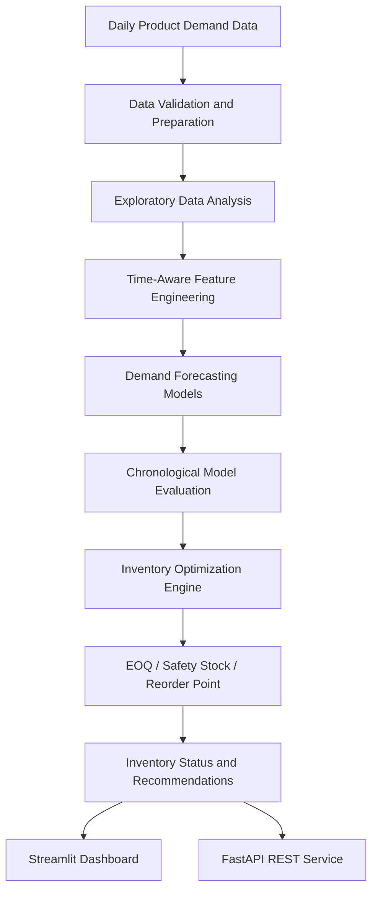

# AI-Powered Supply Chain, Demand Forecasting and Inventory Optimization System

**Predict Demand. Optimize Inventory. Engineer Smarter Supply Chains.**

## Project Overview

An AI-powered supply chain analytics system designed to integrate product-level demand forecasting with intelligent inventory planning and optimization. The system combines historical demand analysis, machine learning-based forecasting, and inventory management techniques to support data-driven replenishment decisions. It leverages forecasting approaches such as **Seasonal Naive and Random Forest Regression**, alongside inventory optimization techniques including **Economic Order Quantity (EOQ), Safety Stock, and Reorder Point** calculations.

An interactive **Streamlit dashboard** and **FastAPI-based REST API** provide capabilities for demand analysis, product-level inventory monitoring, forecasting evaluation, and stock replenishment recommendations.

## Key Objectives

- Develop demand forecasting models for multiple products and SKUs.
- Analyse historical demand patterns, trends, and seasonality.
- Engineer time-aware features for predictive modelling.
- Evaluate forecasting performance using appropriate error metrics.
- Optimize inventory levels using established inventory management techniques.
- Calculate EOQ, safety stock, and reorder points.
- Support intelligent replenishment decisions through interactive analytics.

## Key Capabilities

| Feature | Description |
|---|---|
| Demand Data Generation | Synthetic daily demand generation across multiple SKUs. |
| Data Preprocessing | Data validation, preparation, and exploratory analysis. |
| Feature Engineering | Lag, rolling statistical, calendar, and promotion features. |
| Demand Forecasting | Seasonal Naive and Random Forest forecasting models. |
| Model Evaluation | Chronological holdout evaluation using MAE, RMSE, and WAPE. |
| Inventory Optimization | EOQ, safety stock, and reorder point calculations. |
| Stock Monitoring | Product-level inventory status and days-of-stock-cover analysis. |
| Interactive Dashboard | Streamlit-based demand and inventory analytics. |
| REST API | FastAPI-based inventory recommendation endpoint. |

## System Architecture

The system follows a modular analytics workflow connecting demand data preparation, predictive modelling, inventory optimization, and interactive business intelligence.



## Dataset & Data Generation

The system uses synthetic daily product-demand data generated across multiple Stock Keeping Units (SKUs).

The generated dataset supports experimentation with demand forecasting, product-level analysis, and inventory planning.

Key data attributes include:

- SKU and product identifiers.
- Daily transaction dates.
- Historical product demand.
- Lagged demand observations.
- Rolling demand statistics.
- Calendar and seasonal features.
- Promotional indicators.
- Inventory-related parameters.

Synthetic data provides a reproducible environment for developing and evaluating forecasting and inventory optimization workflows.

## Forecasting Methodology

The forecasting pipeline compares two approaches:

| Model | Purpose |
|---|---|
| Seasonal Naive | Baseline forecasting using demand from the corresponding previous seasonal period. |
| Random Forest Regressor | Machine learning-based demand prediction using engineered features. |

### Feature Engineering

- Historical demand lags.
- Shifted rolling averages.
- Rolling demand variability.
- Calendar-based features.
- Seasonal indicators.
- Promotional features.

### Model Evaluation

Models are evaluated using chronological train-test splitting to preserve the temporal order of observations.

| Metric | Purpose |
|---|---|
| MAE | Measures average absolute forecasting error. |
| RMSE | Penalizes larger prediction errors. |
| WAPE | Measures total absolute error relative to total actual demand. |

The current forecasting example predicts one step ahead using observed historical demand features. Multi-step recursive forecasting and rolling-origin backtesting are planned enhancements.

## Inventory Optimization Methodology

The inventory planning engine applies established inventory management techniques to calculate stock replenishment requirements.

### Economic Order Quantity (EOQ)

Determines an optimal order quantity by balancing ordering and inventory holding costs.

\[
EOQ = \sqrt{\frac{2DS}{H}}
\]

Where:
- D = Annual demand.
- S = Ordering cost per order.
- H = Annual holding cost per unit.

### Safety Stock

Estimates additional inventory required to protect against demand variability during supplier lead time.

\[
Safety\ Stock = z \times \sigma_d \times \sqrt{L}
\]

Where:
- z = Service-level factor.
- σd = Daily demand standard deviation.
- L = Supplier lead time in days.

### Reorder Point (ROP)

Determines when additional stock should be ordered.

\[
ROP = (\text{Average Daily Demand} \times L) + Safety\ Stock
\]

### Additional Inventory Indicators

- Current stock availability.
- Days of stock cover.
- Estimated replenishment requirements.
- Inventory risk status.
- Product-level stock recommendations.

*These calculations use simplified assumptions. Real-world implementation should account for supplier lead-time variability, demand dependencies, review policies, minimum order quantities, and operational constraints.*

## Technology Stack

| Category | Technologies |
|---|---|
| Programming | Python |
| Data Processing | Pandas, NumPy |
| Machine Learning | Scikit-learn, Random Forest |
| Forecasting | Seasonal Naive, Random Forest Regression |
| Statistical Analysis | Descriptive Statistics, Time-Series Analysis |
| Visualization | Matplotlib, Plotly |
| Dashboard | Streamlit |
| Backend | FastAPI |
| Data Storage | CSV |
| Development | Jupyter Notebook, VS Code |
| Version Control | Git, GitHub |

## API Usage – Inventory Recommendation

The FastAPI service provides an inventory recommendation endpoint that accepts product-level demand and inventory parameters.

### Key Input Parameters

- **SKU:** Unique product identifier.
- **Demand Metrics:** Average daily demand and demand variability.
- **Lead Time:** Supplier delivery duration in days.
- **Current Stock:** Available inventory quantity.
- **Annual Demand:** Estimated yearly product demand.
- **Cost Parameters:** Ordering cost and annual holding cost per unit.
- **Service Level:** Desired inventory availability level.

The API processes these inputs to calculate inventory recommendations and support replenishment planning.

API documentation is accessible through:

`http://127.0.0.1:8000/docs`

## Installation & Quick Start

**1. Clone the repository**

```bash
git clone <your-repository-url>
cd SupplyChainIQ
```

**2. Create a virtual environment**

```bash
python -m venv venv
```

**3. Activate the environment**

Windows:

```bash
venv\Scripts\activate
```

Linux / macOS:

```bash
source venv/bin/activate
```

**4. Install dependencies**

```bash
pip install -r requirements.txt
```

**5. Generate synthetic demand data**

Run the project's data preparation script.

**6. Train and evaluate forecasting models**

Execute the model training and evaluation pipeline.

**7. Launch the Streamlit dashboard**

```bash
streamlit run dashboard/app.py
```

**8. Start the FastAPI backend**

```bash
uvicorn api.main:app --reload
```

*Refer to the project documentation for the exact data generation, training, and evaluation commands.*

## Repository Structure

```text
SupplyChainIQ/
├── README.md
├── docs/
├── data/
├── notebooks/
├── src/
│   └── supplychainiq/
├── dashboard/
│   └── app.py
├── api/
│   └── main.py
├── models/
├── reports/
├── tests/
├── scripts/
├── requirements.txt
├── config.yaml
└── LICENSE
```

## Future Enhancements & Roadmap

- Expand forecasting capabilities with XGBoost, LightGBM, and LSTM models.
- Implement rolling-origin validation for improved forecasting reliability.
- Integrate promotional, pricing, holiday, and supplier lead-time variables.
- Introduce ABC/XYZ inventory classification and segmentation.
- Develop probabilistic demand forecasting and service-level optimization.
- Simulate demand fluctuations and supplier-delay scenarios.
- Implement database integration, authentication, and role-based access control.
- Containerize the application using Docker and enable cloud deployment.
- Integrate approved ERP and Warehouse Management System (WMS) data sources.

## Responsible Use & Limitations

- Use synthetic, public, or explicitly authorized business data.
- Do not upload confidential sales, supplier, employee, or customer information.
- Forecasting accuracy depends on data quality, stockout censoring, promotions, product lifecycle, and structural changes.
- Validate inventory assumptions with supply-chain professionals before implementing operational recommendations.

## Author

**Mohamed Riyaz S.**  
Integrated M.Tech – Computer Science and Engineering (Business Analytics)  
Vellore Institute of Technology (VIT), Chennai
