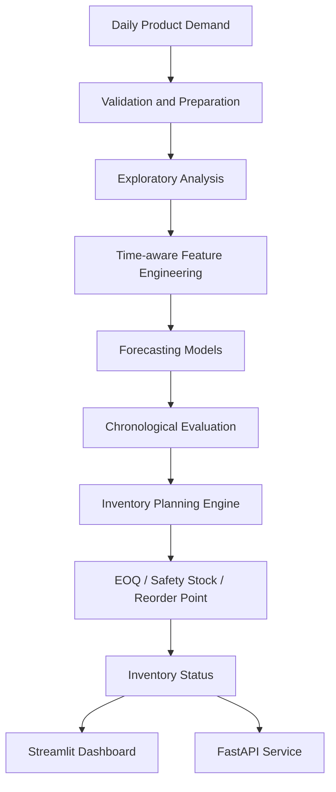

# 📦 SupplyChainIQ
### AI-Powered Supply Chain, Demand Forecasting and Inventory Optimization System

**Predict Demand. Optimize Inventory. Engineer Smarter Supply Chains.**

SupplyChainIQ is an extensible analytics prototype connecting product-level demand forecasting with inventory planning. It includes synthetic daily-demand data, time-aware feature engineering, forecasting baselines, inventory calculations (EOQ, safety stock and reorder point), a Streamlit dashboard, a FastAPI endpoint, tests and technical documentation.

> **Project status:** Educational/portfolio prototype. The bundled data is synthetic. This project does not connect to live ERP, WMS, supplier or point-of-sale systems. Forecasts and replenishment calculations are decision-support estimates, not guaranteed optimal decisions.

## Key capabilities
- Synthetic daily demand generation for multiple SKUs
- Data validation, EDA-ready data and lag/rolling/calendar features
- Seasonal-naive and Random Forest forecasting baselines
- Chronological holdout evaluation using MAE, RMSE and WAPE
- EOQ, safety stock, reorder point and days-of-stock-cover calculations
- Product-level demand dashboard and inventory calculator
- FastAPI inventory recommendation endpoint
- Reproducible scripts, notebooks, tests and documentation

## Architecture


## Repository structure
```text
SupplyChainIQ/
├── README.md
├── docs/                 # Project and technical documentation
├── data/                 # Synthetic sample, raw and processed placeholders
├── notebooks/            # Seven Jupyter workflow starters
├── src/supplychainiq/    # Reusable Python modules
├── dashboard/app.py      # Streamlit dashboard
├── api/main.py           # FastAPI service
├── models/               # Trained model artifacts (generated locally)
├── reports/              # Evaluation output and figures
├── tests/                # Automated tests
├── scripts/              # Data preparation and training commands
├── requirements.txt
├── config.yaml
└── LICENSE
```

## Quick start
### 1. Environment
**Windows PowerShell**
```powershell
python -m venv .venv
.venv\Scripts\Activate.ps1
```
**macOS/Linux**
```bash
python -m venv .venv
source .venv/bin/activate
```
### 2. Install
```bash
pip install -r requirements.txt
```
### 3. Generate synthetic data
```bash
python scripts/prepare_data.py --rows 12000
```
### 4. Train and evaluate
```bash
python scripts/train_models.py
```
Metrics are saved to `reports/evaluation/forecast_metrics.json`.
### 5. Run dashboard
```bash
streamlit run dashboard/app.py
```
### 6. Run API (optional, separate terminal)
```bash
uvicorn api.main:app --reload
```
API docs: http://127.0.0.1:8000/docs

## Forecasting methodology
The starter compares a 7-day seasonal-naive benchmark with a Random Forest regressor using prior demand lags, shifted rolling statistics and calendar/promotion features. The evaluation period is chronologically later than the training period. The example predicts one step ahead using observed historical lags; multi-step recursive forecasting and rolling-origin backtesting are future extensions.

Metrics:
- **MAE:** average absolute error in demand units.
- **RMSE:** penalizes larger errors.
- **WAPE:** total absolute error divided by total actual demand; handles zero-valued individual observations more safely than MAPE.

## Inventory calculations
- **EOQ:** `sqrt((2 × annual demand × order cost) / annual holding cost per unit)`
- **Safety stock:** simplified `z × daily demand standard deviation × sqrt(lead time)`
- **Reorder point:** `average daily demand × lead time + safety stock`

These formulas make simplifying assumptions. Real policies should consider lead-time variability, demand/lead-time dependence, review cadence, service-level definitions, supplier minimums, pack sizes, perishability, capacity and inbound orders.

## API example
`POST /recommendation`
```json
{
  "sku": "SKU-0001",
  "avg_daily_demand": 18.5,
  "daily_demand_std": 4.2,
  "lead_time_days": 7,
  "current_stock": 95,
  "annual_demand": 6752.5,
  "order_cost": 250,
  "annual_holding_cost_per_unit": 35,
  "service_level_z": 1.65
}
```

## Testing
```bash
pytest -q
```

## Roadmap
- [ ] XGBoost and LightGBM comparisons
- [ ] LSTM experiments with rolling-origin validation
- [ ] Promotion, price, holiday and supplier lead-time features
- [ ] ABC/XYZ inventory segmentation
- [ ] Probabilistic forecasts and service-level optimization
- [ ] Demand spike and supplier-delay scenario analysis
- [ ] Database, authentication and role-based access
- [ ] Docker and cloud deployment
- [ ] Approved ERP/WMS data connectors

## Responsible use and limitations
Use synthetic, public or explicitly authorized business data. Do not commit confidential sales, supplier, employee or customer information. Forecast quality depends on data quality, stockout censoring, promotions, product lifecycle and structural changes. Validate assumptions with supply-chain professionals before acting on recommendations.

## Author
**Mohamed Riyaz S.** — Computer Science & Engineering | Business Analytics

## License
MIT License. See [LICENSE](LICENSE).
