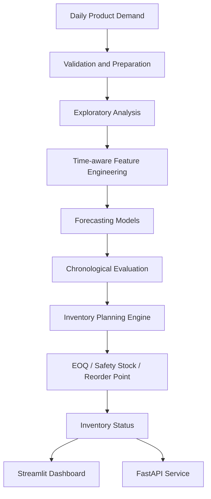

#  SupplyChainIQ
### AI-Powered Supply Chain, Demand Forecasting and Inventory Optimization System

**Predict Demand. Optimize Inventory. Engineer Smarter Supply Chains.**

SupplyChainIQ is an extensible analytics prototype connecting product-level demand forecasting with inventory planning. It includes synthetic daily-demand data, time-aware feature engineering, forecasting baselines, inventory calculations (EOQ, safety stock and reorder point), a Streamlit dashboard, a FastAPI endpoint, tests and technical documentation.


## Key capabilities
- Synthetic daily demand generation for multiple SKUs
- Data validation, EDA-ready data and lag/rolling/calendar features
- Seasonal-naive and Random Forest forecasting baselines
- Chronological holdout evaluation using MAE, RMSE and WAPE
- EOQ, safety stock, reorder point and days-of-stock-cover calculations
- Product-level demand dashboard and inventory calculator
- FastAPI inventory recommendation endpoint
- Reproducible scripts, notebooks, tests and documentation

## Architecture


## Repository structure
```text
SupplyChainIQ/
├── README.md
├── docs/                 # Project and technical documentation
├── data/                 # Synthetic sample, raw and processed placeholders
├── notebooks/            # Seven Jupyter workflow starters
├── src/supplychainiq/    # Reusable Python modules
├── dashboard/app.py      # Streamlit dashboard
├── api/main.py           # FastAPI service
├── models/               # Trained model artifacts (generated locally)
├── reports/              # Evaluation output and figures
├── tests/                # Automated tests
├── scripts/              # Data preparation and training commands
├── requirements.txt
├── config.yaml
└── LICENSE
```

## **Quick Start**

- Create and activate a Python virtual environment.
- Install the required dependencies from `requirements.txt`.
- Generate synthetic demand forecasting data using the preparation script.
- Train and evaluate the forecasting models.
- Save evaluation metrics in `reports/evaluation/forecast_metrics.json`.
- Launch the interactive Streamlit dashboard.
- Optionally start the FastAPI backend and access API documentation at `http://127.0.0.1:8000/docs`.

## Forecasting methodology
The starter compares a 7-day seasonal-naive benchmark with a Random Forest regressor using prior demand lags, shifted rolling statistics and calendar/promotion features. The evaluation period is chronologically later than the training period. The example predicts one step ahead using observed historical lags; multi-step recursive forecasting and rolling-origin backtesting are future extensions.

Metrics:
- **MAE:** average absolute error in demand units.
- **RMSE:** penalizes larger errors.
- **WAPE:** total absolute error divided by total actual demand; handles zero-valued individual observations more safely than MAPE.

## Inventory calculations
- **EOQ:** `sqrt((2 × annual demand × order cost) / annual holding cost per unit)`
- **Safety stock:** simplified `z × daily demand standard deviation × sqrt(lead time)`
- **Reorder point:** `average daily demand × lead time + safety stock`

These formulas make simplifying assumptions. Real policies should consider lead-time variability, demand/lead-time dependence, review cadence, service-level definitions, supplier minimums, pack sizes, perishability, capacity and inbound orders.

## **API Usage – Inventory Recommendation**

The /recommendation API endpoint accepts a POST request containing essential inventory and demand-related parameters to generate intelligent stock replenishment recommendations.

Key input parameters:
- SKU: Unique product identifier.
- Demand Metrics: Average daily demand and demand variability.
- Lead Time: Supplier delivery duration in days.
- Current Stock: Available inventory quantity.
- Annual Demand: Estimated yearly product demand.
- Cost Parameters: Ordering cost and annual holding cost per unit.
- Service Level: Desired inventory availability level.
The API processes these inputs to support optimized replenishment planning, inventory cost management, and data-driven stock decisions.


## **Future Enhancements & Roadmap**

- Expand forecasting capabilities with XGBoost, LightGBM, and LSTM models.
- Implement rolling-origin validation for improved forecasting reliability.
- Integrate promotional, pricing, holiday, and supplier lead-time variables.
- Introduce ABC/XYZ inventory classification and segmentation.
- Develop probabilistic demand forecasting and service-level optimization.
- Simulate demand fluctuations and supplier-delay scenarios.
- Implement database integration, authentication, and role-based access control.
- Containerize the application using Docker and enable cloud deployment.
- Integrate approved ERP and Warehouse Management System (WMS) data sources.

## Responsible use and limitations
Use synthetic, public or explicitly authorized business data. Do not commit confidential sales, supplier, employee or customer information. Forecast quality depends on data quality, stockout censoring, promotions, product lifecycle and structural changes. Validate assumptions with supply-chain professionals before acting on recommendations.

## Author

**Mohamed Riyaz S.**  
Integrated M.Tech, Computer Science and Engineering (Business Analytics)  
VIT Chennai
